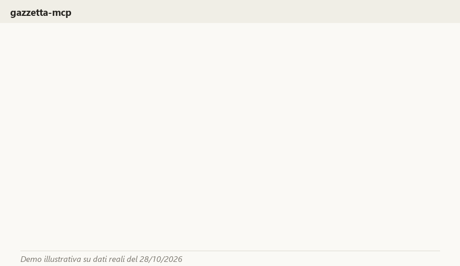

# gazzetta-mcp

[](https://pepy.tech/projects/gazzetta-mcp)

<!-- mcp-name: io.github.GiovannaFilippini/gazzetta-mcp -->

Unofficial, local [MCP](https://modelcontextprotocol.io) server that lets your AI assistant
consult the Italian *Gazzetta Ufficiale*. Free, open source (MIT). No codes or dates needed.

English | [Italiano](#italiano)



*Illustrative demo built from a real result of 28 Oct 2026.*

**What you can ask your assistant:**

- "Are there public competitions for nurses in Lombardy?"
- "What came out in the Gazzetta today?"
- "Give me the text of the decree on ..., summarised in three points."
- "Give me the Normattiva link for law 241/1990."

Results can be partial: the server sees recent publications and what it has already looked up,
not the whole archive, and it says so. Ready to try it? Go to [Install](#install).

## Disclaimer

**This project is NOT an official publication and is not affiliated with the Gazzetta Ufficiale
or the Istituto Poligrafico e Zecca dello Stato.** The texts it returns are **not authentic**
and are provided **free of charge**. The only definitive text is the one published in the
Gazzetta Ufficiale in print, which prevails in case of discrepancy. Every response includes the
source and the official link; always check the official text before relying on it.

Reference wording from the source site: *"L'unico testo definitivo e' quello pubblicato sulla
Gazzetta Ufficiale a mezzo stampa, che prevale in caso di discordanza. La riproduzione dei testi
forniti nel formato elettronico e' consentita purche' venga menzionata la fonte, il carattere non
autentico e gratuito."*

## Usage policy

- Requests are made **on demand only**, when you or your assistant ask for something.
- **No bulk download** and no mirroring of the site.
- Results are kept in a **local cache** (SQLite) on your machine.
- Outgoing requests are **rate limited** (default 1 per second).
- Besides the Gazzetta Ufficiale, `cerca` queries the Normattiva Open Data API (one request per
  search, cached for 24 hours); it can be switched off (see [Configuration](#configuration)).
- Requests carry an **identifying User-Agent** (`gazzetta-mcp/<version> (unofficial open source client)`).

These are our own choices for the local server, not rules imposed by the source; the source only
requires citing it and stating that texts are non-authentic and free. Please keep these defaults
respectful of the source. See [docs/fonti.md](docs/fonti.md).

## Tools

| Tool | Parameters | What it does |
|---|---|---|
| `ultime_pubblicazioni` | `serie`, `giorni` | Latest publications of a series (SG, S1-S5, P2) over the last N days |
| `sommario` | `data`, `serie` | Table of contents of the issue of a given date and series |
| `leggi_atto` | `codice`, `data`, `serie`, `offset` | Text of an act from its editorial code (e.g. `26A05182`) |
| `cerca_concorsi` | `parole_chiave`, `regione`, `aperti`, `includi_altri_atti`, `limite` | Search public competitions from a cold start: loads the last ~30 days of the 4th series (a handful of rate-limited requests, then cached), states the coverage |
| `rimando_normattiva` | `atto` | Builds the permanent Normattiva link for an act (link only, no download) |
| `cerca` | `testo`, `serie`, `tipo`, `dal`, `al`, `limite`, `aggiorna`, `solo_vigenti`, `periodo` | Search titles and issuing bodies of recent issues (SG about 30 days, S4 last 9: refreshed first, bounded), of everything already cached and, for laws and decrees of any year, of the Normattiva Open Data archive (results marked `origine: normattiva`); repealed acts are left out by default; full act texts only if already read |

Series codes: `SG` Serie Generale, `S1` Corte Costituzionale, `S2` Unione Europea, `S3` Regioni,
`S4` Concorsi ed esami, `S5` Contratti pubblici, `P2` Parte II.

## Install

The easiest way is [uv](https://docs.astral.sh/uv/getting-started/installation/), a small free
tool that downloads and runs the server for you (it provides the `uvx` command, and fetches a
suitable Python if you do not have one). On Windows, open PowerShell and run
`winget install --id astral-sh.uv`, then reopen the terminal. With `pip` you need Python 3.10+.

```bash
uvx gazzetta-mcp
# or
pip install gazzetta-mcp
```

### One-click install (Claude Desktop)

Download `gazzetta-mcp-0.1.0.mcpb` from the
[latest release](https://github.com/GiovannaFilippini/gazzetta-mcp/releases/latest) and
double-click it (or open it from Claude Desktop, Settings > Extensions). No terminal needed.
The bundle is built from [mcpb](mcpb) and installs the same `gazzetta-mcp` package from PyPI.

### Development version (from GitHub)

```bash
uvx --from git+https://github.com/GiovannaFilippini/gazzetta-mcp gazzetta-mcp
```

## Configure your MCP client

**Claude Code**

```bash
claude mcp add gazzetta -- uvx gazzetta-mcp
```

**Claude Desktop** (`claude_desktop_config.json`)

```json
{
  "mcpServers": {
    "gazzetta": {
      "command": "uvx",
      "args": ["gazzetta-mcp"]
    }
  }
}
```

**Cursor** (`~/.cursor/mcp.json`) and **Windsurf**: same `mcpServers` block as Claude Desktop.

**VS Code** (`.vscode/mcp.json`)

```json
{ "servers": { "gazzetta": { "type": "stdio", "command": "uvx", "args": ["gazzetta-mcp"] } } }
```

**Generic stdio client**: run the command `gazzetta-mcp` (or `uvx gazzetta-mcp`) and speak MCP
over stdin/stdout.

To use the development version, replace the command/args with
`uvx --from git+https://github.com/GiovannaFilippini/gazzetta-mcp gazzetta-mcp`.

## Configuration

All settings are environment variables, read in `src/gazzetta_mcp/config.py`.

| Variable | Default | Meaning |
|---|---|---|
| `GAZZETTA_MCP_GU_BASE_URL` | `https://www.gazzettaufficiale.it` | Base URL of the Gazzetta Ufficiale site |
| `GAZZETTA_MCP_NORMATTIVA_BASE_URL` | `https://www.normattiva.it` | Base URL used for Normattiva links |
| `GAZZETTA_MCP_NORMATTIVA_API_URL` | `https://api.normattiva.it/t/normattiva.api/bff-opendata/v1/api/v1` | Normattiva Open Data API used by the archive search |
| `GAZZETTA_MCP_ARCHIVIO_NORMATTIVA` | `1` | Set to `0` to stop `cerca` from querying the Normattiva archive |
| `GAZZETTA_MCP_ARCHIVIO_GIORNI` | `365` | Period searched in the archive when no `dal` is given |
| `GAZZETTA_MCP_ARCHIVIO_TIMEOUT` | `90.0` | Timeout in seconds for the archive search (slow with date filters) |
| `GAZZETTA_MCP_RICERCA_GU` | `0` | Set to `1` to enable the Gazzetta Ufficiale advanced search form (off by default: its terms of use do not mention automated use) |
| `GAZZETTA_MCP_RPS` | `1.0` | Maximum requests per second |
| `GAZZETTA_MCP_TIMEOUT` | `20.0` | HTTP timeout in seconds |
| `GAZZETTA_MCP_CACHE_PATH` | `<cache dir>/gazzetta-mcp/cache.sqlite3` | SQLite cache file (`LOCALAPPDATA`, else `XDG_CACHE_HOME`, else `~/.cache`) |
| `GAZZETTA_MCP_FEED_TTL` | `900` | Feed cache lifetime in seconds |
| `GAZZETTA_MCP_USER_AGENT` | `gazzetta-mcp/<version> (unofficial open source client)` | User-Agent sent with requests |

## Troubleshooting

First run `gazzetta-mcp --prova` (or `uvx gazzetta-mcp --prova`): it checks Python, local search,
the cache folder and the connection (one request) and tells you what to fix.

- **The assistant does not see the tool**: restart the assistant completely after adding the
  server, check the command in its configuration (see above), and run `--prova`.
- **Empty results**: try other or fewer keywords, or ask what came out recently. Results can be
  partial (see above); check the official site if something is missing.
- **The first search is slow**: the first request builds the local cache. Later ones are faster.
- **Where is the cache?** In `<cache dir>/gazzetta-mcp/cache.sqlite3` (see `GAZZETTA_MCP_CACHE_PATH`
  above; on Windows `%LOCALAPPDATA%\gazzetta-mcp`).
- **Clear the cache**: close the assistant, then run `gazzetta-mcp --svuota-cache --si`
  (without `--si` it only shows what would be deleted).

## Development

```bash
uv sync
uv run pytest            # no network needed
uv run ruff check .
uv run pytest --live     # also runs tests that call the real sites (use sparingly)
```

See [CONTRIBUTING.md](CONTRIBUTING.md), [docs/piano.md](docs/piano.md) and
[docs/decisioni](docs/decisioni).

## License

[MIT](LICENSE). The license covers the code only; the texts remain subject to the rules of their
sources (see [docs/fonti.md](docs/fonti.md)).

**Sources and attribution.** Gazzetta Ufficiale texts may be reproduced if the source is cited and
their non-authentic, free nature is stated: every response does so. Archive search results marked
`origine: normattiva` come from *Normattiva Open Data* (dati.normattiva.it), released under
[CC BY 4.0](https://creativecommons.org/licenses/by/4.0/): if you reuse them, credit the source.

---

## Italiano

Server [MCP](https://modelcontextprotocol.io) locale, **non ufficiale**, che permette al tuo
assistente AI di consultare la *Gazzetta Ufficiale*. Gratuito e open source (licenza MIT).
Non servono codici né date.

**Cosa puoi chiedere all'assistente:**

- "Ci sono concorsi per infermiere in Lombardia?"
- "Cosa è uscito oggi in Gazzetta?"
- "Dammi il testo del decreto su ..., riassunto in tre punti."
- "Dammi il link Normattiva della legge 241/1990."

I risultati possono essere parziali: il server vede le pubblicazioni recenti e ciò che ha già
consultato, non tutto l'archivio, e lo dice. Pronto a provarlo? Vai a
[Installazione](#installazione).

### Come si usa

1. **Collega la Gazzetta all'assistente** (una volta sola, vedi "Installazione" e
   "Configurazione del client MCP"), poi riavvia l'assistente.
2. **Scrivi cosa ti serve con parole tue**, senza codici o date: "Ci sono concorsi per infermiere
   in Lombardia?", "Cosa è uscito oggi in Gazzetta?", "Dammi il link Normattiva della legge
   241/1990."
3. **Apri sempre il link ufficiale** riportato nella risposta: i testi non sono ufficiali e i
   risultati possono essere incompleti.

Altri esempi in [docs/uso.md](docs/uso.md).

### Avvertenza

**Questo progetto NON è una pubblicazione ufficiale e non è affiliato alla Gazzetta Ufficiale
né all'Istituto Poligrafico e Zecca dello Stato.** I testi restituiti hanno **carattere non
autentico** e sono forniti **gratuitamente**. L'unico testo definitivo è quello pubblicato sulla
Gazzetta Ufficiale a mezzo stampa, che prevale in caso di discordanza. Ogni risposta riporta la
fonte e il link ufficiale: verifica sempre il testo ufficiale prima di farci affidamento.

### Regole d'uso

- Le richieste partono **solo su richiesta** dell'utente.
- **Nessun download massivo**, nessuna copia del sito.
- I risultati restano in una **cache locale** (SQLite) sul tuo computer.
- Le richieste in uscita hanno un **limite di frequenza** (predefinito: 1 al secondo).
- Oltre alla Gazzetta Ufficiale, `cerca` interroga l'API Open Data di Normattiva (una richiesta per
  ricerca, in cache per 24 ore); si può disattivare (vedi la tabella "Configuration").
- Le richieste usano uno **user-agent identificativo** (`gazzetta-mcp/<versione> (unofficial open source client)`).

Sono scelte nostre per il server locale, non regole imposte dalla fonte, che chiede solo di citarla
e di dichiarare il carattere non autentico e gratuito dei testi. Vedi [docs/fonti.md](docs/fonti.md).

### Strumenti

| Strumento | Parametri | Cosa fa |
|---|---|---|
| `ultime_pubblicazioni` | `serie`, `giorni` | Ultime pubblicazioni di una serie negli ultimi N giorni |
| `sommario` | `data`, `serie` | Sommario del numero di una data e serie |
| `leggi_atto` | `codice`, `data`, `serie`, `offset` | Testo di un atto dal codice redazionale (es. `26A05182`) |
| `cerca_concorsi` | `parole_chiave`, `regione`, `aperti`, `includi_altri_atti`, `limite` | Cerca bandi (4a serie) anche a cache vuota: carica gli ultimi 30 giorni (poche richieste distanziate, poi in cache) e dichiara la copertura |
| `rimando_normattiva` | `atto` | Costruisce il link permanente a Normattiva (solo link) |
| `cerca` | `testo`, `serie`, `tipo`, `dal`, `al`, `limite`, `aggiorna`, `solo_vigenti`, `periodo` | Ricerca nei titoli e negli enti dei numeri recenti (SG circa 30 giorni, S4 ultimi 9: aggiornati prima, con tetto), in ciò che è in cache e, per leggi e decreti di qualsiasi anno, nell'archivio Open Data di Normattiva (origine `normattiva`); gli atti abrogati sono esclusi di default; il testo completo solo per gli atti già letti |

Sigle delle serie: `SG` Serie Generale, `S1` Corte Costituzionale, `S2` Unione Europea,
`S3` Regioni, `S4` Concorsi ed esami, `S5` Contratti pubblici, `P2` Parte II.

Esempi di richieste in linguaggio naturale: [docs/uso.md](docs/uso.md).

### Installazione

Il modo più semplice è [uv](https://docs.astral.sh/uv/getting-started/installation/), un piccolo
programma gratuito che scarica e avvia il server al posto tuo (fornisce il comando `uvx` e, se
manca, scarica anche un Python adatto). Su Windows apri PowerShell, scrivi
`winget install --id astral-sh.uv`, poi chiudi e riapri il terminale. Con `pip` serve Python 3.10+.

```bash
uvx gazzetta-mcp
# oppure
pip install gazzetta-mcp
```

**Installazione con un clic (Claude Desktop):** scarica `gazzetta-mcp-0.1.0.mcpb` dall'[ultima
release](https://github.com/GiovannaFilippini/gazzetta-mcp/releases/latest) e aprilo con doppio
clic (oppure da Claude Desktop, Impostazioni > Estensioni). Non serve il terminale. Il pacchetto
è costruito da [mcpb](mcpb) e installa lo stesso pacchetto `gazzetta-mcp` di PyPI.

**Versione di sviluppo** (da GitHub):

```bash
uvx --from git+https://github.com/GiovannaFilippini/gazzetta-mcp gazzetta-mcp
```

### Configurazione del client MCP

- Claude Code: `claude mcp add gazzetta -- uvx gazzetta-mcp`
- Claude Desktop: aggiungi a `claude_desktop_config.json` il blocco `mcpServers` mostrato sopra.
- Altri client: avvia `gazzetta-mcp` come server stdio.

Le variabili d'ambiente `GAZZETTA_MCP_*` sono descritte nella tabella
[Configuration](#configuration) più sopra (in inglese).

### Se qualcosa non funziona

Lancia prima `gazzetta-mcp --prova` (o `uvx gazzetta-mcp --prova`): controlla Python, la ricerca
locale, la cartella della cache e il collegamento (una sola richiesta) e dice cosa sistemare.

- **L'assistente non vede lo strumento**: riavvia del tutto l'assistente dopo aver aggiunto il
  server, controlla il comando nella configurazione e lancia `--prova`.
- **Nessun risultato**: prova parole chiave diverse o meno numerose, oppure chiedi cosa è uscito
  di recente. I risultati possono essere parziali; se manca qualcosa controlla il sito ufficiale.
- **La prima ricerca è lenta**: la prima richiesta costruisce la memoria locale (cache); le
  successive sono più veloci.
- **Dove sta la cache**: in `<cartella cache>/gazzetta-mcp/cache.sqlite3` (su Windows
  `%LOCALAPPDATA%\gazzetta-mcp`), modificabile con `GAZZETTA_MCP_CACHE_PATH`.
- **Svuotare la cache**: chiudi l'assistente e lancia `gazzetta-mcp --svuota-cache --si` (senza
  `--si` mostra soltanto cosa verrebbe cancellato).

### Sviluppo

```bash
uv sync
uv run pytest          # senza rete
uv run ruff check .
uv run pytest --live   # include i test sui siti reali
```

Vedi [CONTRIBUTING.md](CONTRIBUTING.md). Licenza: [MIT](LICENSE) (vale per il codice; i testi
restano soggetti alle regole delle fonti, vedi [docs/fonti.md](docs/fonti.md)).

**Fonti e attribuzione.** I testi della Gazzetta Ufficiale si possono riprodurre citando la fonte e
dichiarandone il carattere non autentico e gratuito: ogni risposta lo fa. I risultati della ricerca
nell'archivio con `origine: normattiva` provengono da *Normattiva Open Data* (dati.normattiva.it),
rilasciati con licenza [CC BY 4.0](https://creativecommons.org/licenses/by/4.0/): se li riusi, la
fonte va citata.
